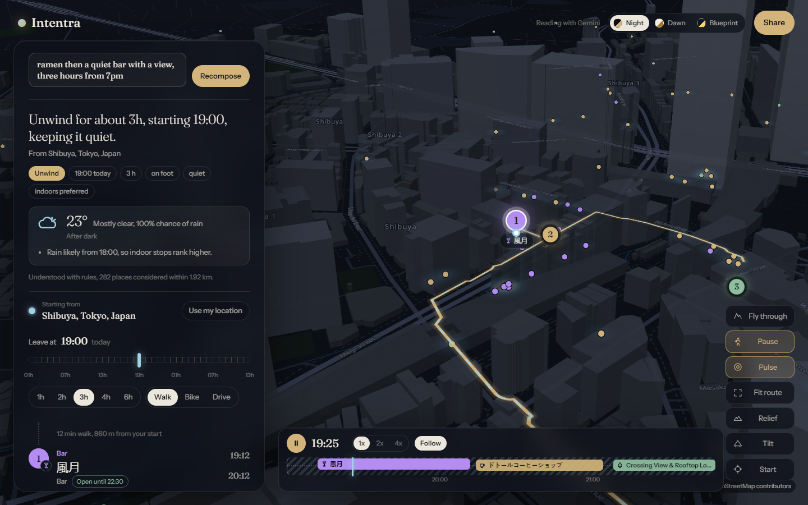

# IntentIQ

Tell it what you want from the next few hours. It compiles that sentence into a timed, routed,
explainable itinerary through the real city, drawn on a 3D night map.

```
"First date tonight at 7, dinner then a walk with a view, nothing loud"

  19:02  Ease in      Madras Coffee House      2 min walk from your start
  19:46  Dinner       Pind Balluchi            4 min walk, open until 23:00
  21:14  Walk it off  Pandit Ramkeval Mishra Park   8 min walk

  Dessert: nothing open in reach for this part of the plan.
  With 45 more minutes we would add Palika Park.
  Leaving two hours later, Pind Balluchi would drop out, likely closed by then.
```



Everything above is real: places from OpenStreetMap, opening hours parsed from their listings,
streets from OSRM routing, times that respect how long each stop takes. Nothing is invented.
When the data is missing, the plan says so.

## What makes it different

- **Anywhere on Earth.** Search any city, neighbourhood or landmark (Photon geocoding over
  OpenStreetMap), use your location, or right-click the map and start there. The app opens on a
  turning globe and flies down into the city you pick.
- **Intent compiler.** A deterministic parser reads time, duration, budget, company, transport
  and explicit wishes ("ramen", "with a view"). A language model (Gemini or Claude, optional)
  refines mood and constraints; its output is validated and merged, never trusted blindly, and
  replans reuse the same understanding so the plan never drifts.
- **Time-aware composition.** A beam search walks the plan's arc (ease in, dinner, walk, dessert)
  and only visits places that are open when you would actually arrive. Optional phases drop out
  when time runs short, and every skipped phase is reported as a gap.
- **Weather and daylight in the loop.** Open-Meteo hourly forecasts and sunset times are folded
  into planning: rain ranks indoor places higher, sunset inside the window is called out, and the
  timeline shades the rainy hours.
- **Real routing.** Legs are routed on foot, bike or car through OSRM and drawn on the map.
  If routing is unavailable, distances are labelled as estimates.
- **Explanations you can argue with.** Every stop carries factor bars (fit, timing, proximity,
  listing detail), a plain sentence on why, detail chips from the listing (cuisine, wifi, seats
  outside, step-free, website), ranked alternatives to swap in, "not this place" to exclude one,
  and counterfactuals: what more time, a later start or a bike would change.
- **A time ruler and a timeline.** Drag "Leave at" and the whole plan recomposes. A ribbon along
  the bottom shows every stop across the hours, colour-coded by kind, with sunset and rain marked.
- **Walk it.** Press play and a traveller walks the route in fast time while the camera follows
  the streets; scrub the ribbon to jump anywhere in the evening.
- **Three cartographies, real terrain.** Night, Dawn and Blueprint looks rendered from
  OpenFreeMap vector tiles with extruded buildings, optional relief from Mapzen terrain tiles,
  an animated route, a "pulse" layer of every place considered, and a cinematic fly-through.
- **Shareable and installable.** One link reproduces the exact plan, with a QR code, calendar
  (.ics) and GPX exports, a Google Maps hand-off, plain-text copy, and a web app manifest.

## Layout

```
apps/api   FastAPI service: intent compiler, planner, Overpass and OSRM clients, SQLite plans
apps/web   Vite + React + TypeScript client with MapLibre GL
Dockerfile Single image: the API serves the built web app
```

## Run it locally

API (Python 3.12+):

```bash
cd apps/api
python -m venv .venv
.venv/Scripts/pip install -r requirements.txt      # or .venv/bin/pip on macOS/Linux
cp .env.example .env                               # add GEMINI_API_KEY to enable the language model
.venv/Scripts/uvicorn app.main:app --port 8010 --reload
```

Web:

```bash
cd apps/web
npm install
npm run dev                                        # http://localhost:5173, proxies /api to :8010
```

Docs live at `http://localhost:8010/api/docs`.

## Tests and checks

```bash
cd apps/api && ruff check . && pytest -q           # 32 tests: hours parser, intent, planner, weather, API contract
cd apps/web && npm run typecheck && npm test && npm run build
```

## Production

```bash
docker compose up --build                          # http://localhost:8000
```

The container serves the web app and the API together, stores shared plans in a volume, and
exposes `/api/health` for probes. Set `CORS_ORIGINS`, `RATE_LIMIT_PER_MINUTE` and `LLM_PROVIDER`
through the environment. See `apps/api/.env.example` for every setting.

## API

| Method | Path | Purpose |
| --- | --- | --- |
| POST | `/api/plan` | Compile a wish into an itinerary |
| POST | `/api/plan/stream` | Same, streamed as server-sent events with progress stages |
| POST | `/api/plans` | Store a plan and get a share id |
| GET | `/api/plans/{id}` | Fetch a shared plan |
| GET | `/api/plans/{id}/calendar.ics` | Calendar export |
| GET | `/api/plans/{id}/route.gpx` | GPX export |
| GET | `/api/geocode?q=` | Search anywhere in the world for a start |
| GET | `/api/geocode/reverse` | Name a coordinate |
| GET | `/api/meta` | Moods, categories, limits |
| GET | `/api/health` | Liveness, cache and model status |

Request body for `/api/plan`:

```json
{
  "query": "quiet cafe with wifi for 2 hours then a walk",
  "lat": 28.6315,
  "lon": 77.2167,
  "timezone": "Asia/Kolkata",
  "leave_at": "2026-09-25T19:00:00",
  "duration_min": 150,
  "transport": "walk",
  "pins": { "settle": "n3242109751" },
  "exclude": ["n123"]
}
```

`leave_at`, `duration_min`, `transport`, `pins` and `exclude` are optional overrides used by the
time ruler, the controls, the swap-in and "not this place" buttons.

## Data and credits

Places and hours: OpenStreetMap contributors via Overpass (ODbL). Tiles: OpenFreeMap and
OpenMapTiles. Terrain: Mapzen tiles on AWS. Routing: the FOSSGIS OSRM instance. Geocoding:
Photon by komoot. Weather: Open-Meteo. These public services are rate-limited and best-effort;
the API caches results, fails over across Overpass mirrors, and reports outages honestly instead
of fabricating results.
